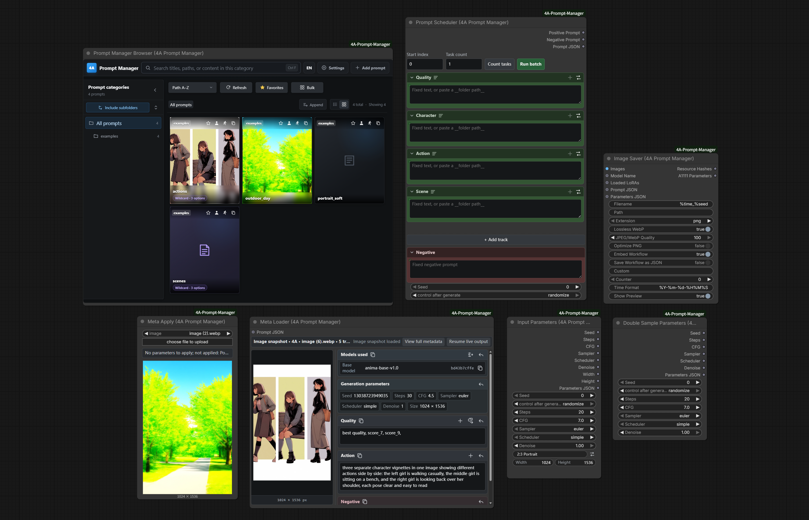
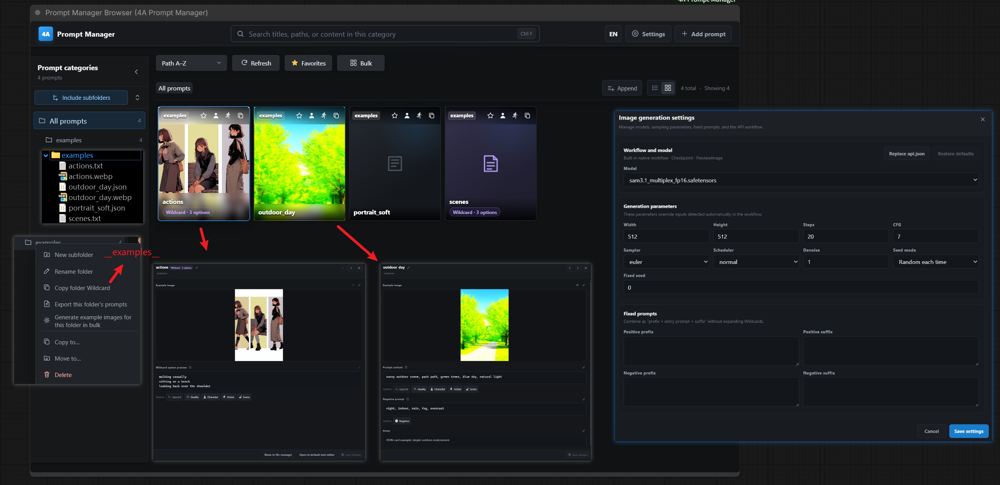
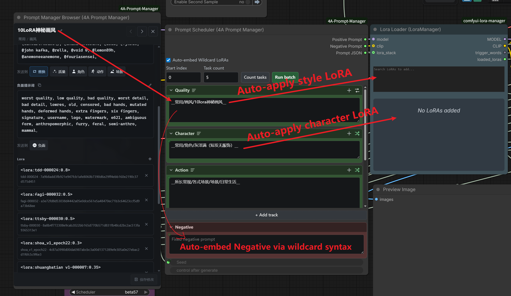
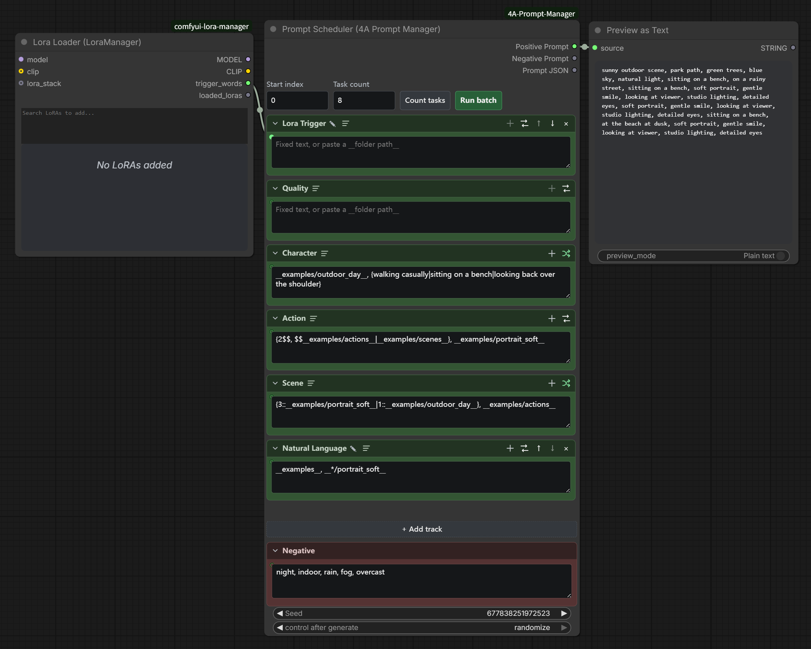
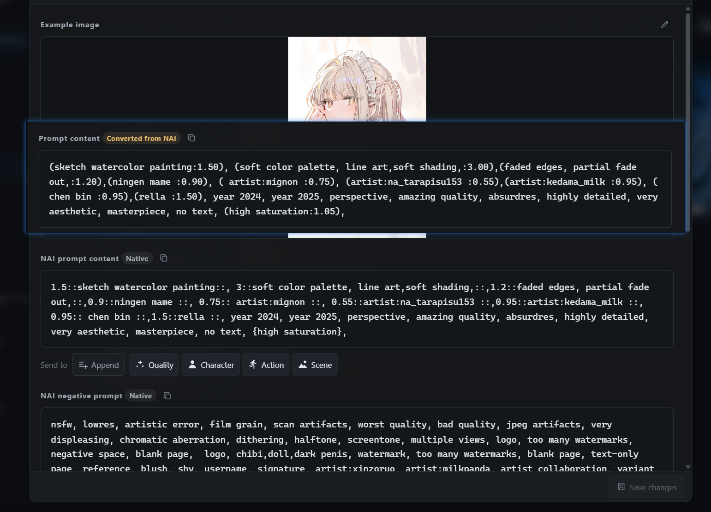
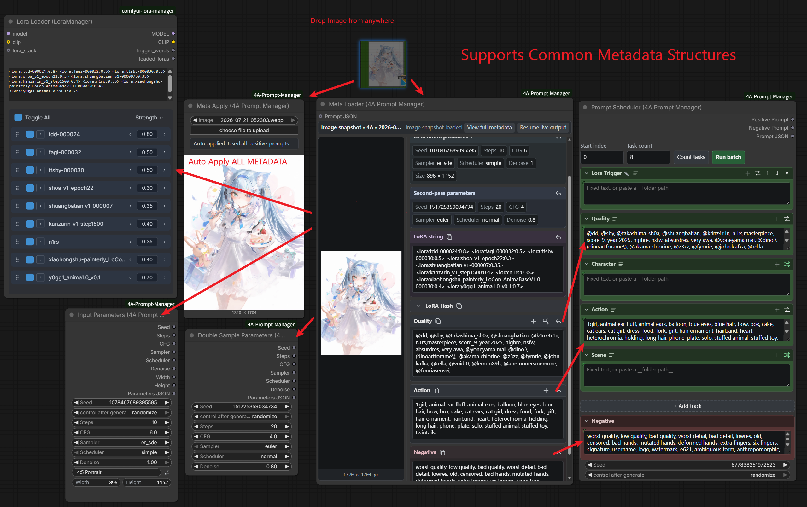
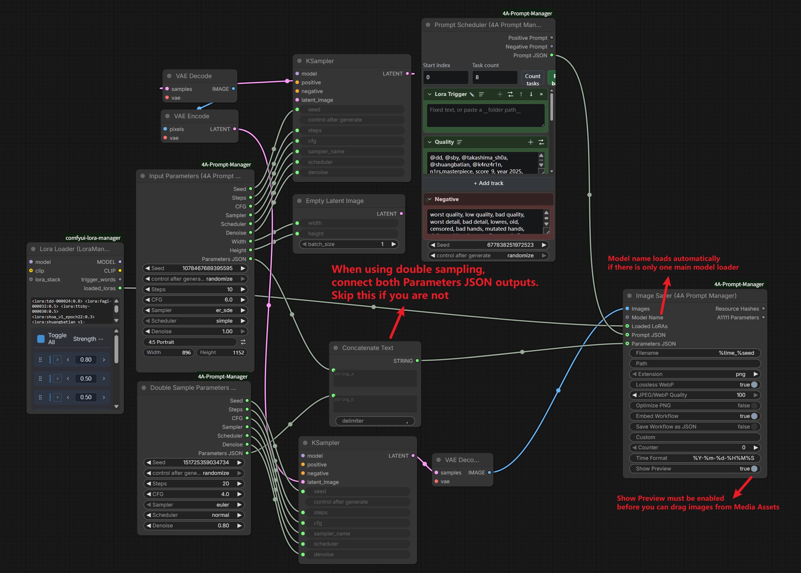

# ComfyUI-4A-Prompt-Manager

[English](README.md)

配套 NovelAI 生图插件：[ComfyUI-4A-NovelAI](https://github.com/tsukino4a/ComfyUI-4A-NovelAI)

中文视频介绍（Bilibili）：https://www.bilibili.com/video/BV1DWKv6NE6t  
更新 #1（Bilibili）：https://www.bilibili.com/video/BV1Ccg86nErh

面向 ComfyUI 的文件夹提示词库与调度器：浏览/编辑 Wildcard 与 JSON 卡片（LoRA + 稀疏生成设置）、多轨拼装提示词、Wildcard 批量时自动套用设置、从图片元数据回填，并保存带便携参数的生成结果。

**当前版本：1.4.4**

- 修复了调度器换行前的逗号被清掉的问题

**1.4.3**

- 缓存 Wildcard 叶子数量，大文件夹 `__key__` 在第一次统计后展开不再全库重扫

**1.4.2**

- 图像保存器只写入已连接或已填写的提示词、参数和哈希；未连接的可选输入不再写入默认值或空结构

**1.4.1**

- 缓存 Wildcard 库快照，官方 Queue 不再每次整库拷贝；没有 `__通配符__` 时直接跳过
- 浏览器的文件夹、视图和发送模式改成按工作流分别记住，不再多图共用一份界面状态

**1.4.0**

- 增加 NovelAI（NAI）Browser 模式、稀疏 `nai` 卡片字段、NAI 图片元数据读取，以及向外部 NAI 节点发送提示词和参数
- 生成节点拆到独立的 [ComfyUI-4A-NovelAI](https://github.com/tsukino4a/ComfyUI-4A-NovelAI)；未安装该插件时 Prompt Manager 仍可单独使用
- Comfy / NAI 权重只在缺原生正文时自动转换；详情页、复制、发送、Wildcard 展开共用同一套规则
- NAI 角色在进入 Comfy 时拍成 `charN:` 行
- 编辑只写回当前模式，不覆盖另一侧的原生文本
- Meta Apply / Meta Loader 预览改为上传后走 `/view` 持久化，换工作流或重启不再丢图



## 亮点

### 完整易用的提示词管理前端

侧栏库界面，提示词按普通文件夹结构保存（JSON 卡片 + TXT Wildcard），复制文件夹即可备份/分享；随意导入导出；可为卡片生成预览图（内置 API 工作流，也可替换成你自己的 `api.json`）。会记住上次文件夹与侧栏展开状态；刷新库后还可按 hash 把卡片模型名对齐到本地文件。



### JSON 卡片 LoRA / 生成设置 + Wildcard 自动套用

JSON 卡片可稀疏绑定 LoRA、模型、推理参数（含 seed/宽高）、双采样参数。未填写的字段不会写入 JSON；有双采样字段块即视为二采 ON（不再单独写 enable）。当 Scheduler 栏目用 Wildcard 语法引用这些卡片时，可分别开启「自动嵌入 Wildcard LoRA」「自动应用模型 / 推理参数」：入队前写入对应节点，跑完恢复画布基线（seed 不恢复）。开启自动嵌入后，可用「相同模型/LoRA 连跑」把同一套栈的任务排在一起，减少反复加载。冲突规则：LoRA 可叠（同名跳过），其余按字段先到先得。**Bypass Switch** 按卡片是否含双采样字段开关——把二采子图/参数节点接到开关上即可（目前全图只支持一个）。建卡拖图默认仍只读提示词；可用「从图片加载生成设置」覆盖加载（已有设置会确认）。详情页也可一键把模型 / LoRA / 参数推到画布。



### 多层 Prompt Scheduler

多轨正面拼装，支持随机 / 顺序 / 洗牌；兼容 Impact 风格 Wildcard 解析（`__key__`、`{a|b}`、权重、多选、文件夹与全局文件名引用）；每个栏位还可从外部连入 STRING。

**嵌套 Wildcard（自动化利器）：** 卡片 `content` / `negative` 与 TXT 正文里都可以再写 `__文件夹__` / `__路径/文件__`。展开时递归解析，并带上内层的 LoRA、负面与稀疏生成设置。顺序批量按**叶子空间**计数/展开：嵌套分支求和、同栏并排 `__a__, __b__` 求积、多栏目取最长；`{a|b}` 等始终随机、不占周期。典型用法是「顶层对比 LoRA/预设，内容里嵌套 `__场景__` / 套件」——点「统计数量」按真实叶子数填任务，而不是只数顶层文件个数。

完整规则与示例见 [`docs/wildcard-nesting.zh-CN.md`](docs/wildcard-nesting.zh-CN.md)。



### NovelAI（NAI）提示词与元数据管理

NAI 生成节点已迁移到独立的 [ComfyUI-4A-NovelAI](https://github.com/tsukino4a/ComfyUI-4A-NovelAI) 插件。本项目只负责提示词卡保存、Wildcard 库、权重显示转换、图片元数据读取/应用，以及把提示词和稀疏参数发送到 NAI 节点；未安装生成插件时 PM4A 仍可独立使用。

- JSON 卡片分别保存通用 `content` / `negative` 与 NAI 原生 `nai.content` / `nai.negative`。Browser 优先显示当前模式的原生文本；缺少时才临时转换另一套文本，用户编辑后只写回当前模式，避免 `{}`、`[]`、`N::text::` 被错误解释。详情页标题旁会标明当前是原生正文还是另一侧的转换预览。
- `nai.parameters` 只稀疏保存 `steps`、`cfg`、`sampler`、`scheduler`、`cfg_rescale`、`width`、`height`；`nai.characters` 按顺序保存每个角色的正负提示词，以及可选的单角色 `x/y`。模型和生成种子仍由独立生成插件的节点管理。
- NAI 图片中的正负面、角色提示词、坐标和采样/尺寸参数继续由 PM4A 的元数据读取器识别，并可应用到 [ComfyUI-4A-NovelAI](https://github.com/tsukino4a/ComfyUI-4A-NovelAI) 的 Scheduler / Sampler。
- NAI 专用 Wildcard 展开、多角色调度、连续坐标定位、串行批量、模型/积分、Reference，以及通过专用图像输入节点切换 txt2img/img2img/inpaint，均由独立生成插件负责。



### 元数据复用（Meta Loader / Meta Apply）

兼容常见图片格式。可从前端节点、系统外部或 ComfyUI 资产任意拖入图片；一键复用嵌入的提示词、推理参数与 LoRA（LoRA 回填需安装 [Lora Manager](https://github.com/willmiao/ComfyUI-Lora-Manager)）。Meta Apply 可分别开关：模型、LoRA、推理参数、提示词；套用推理参数时也会按有无双采样字段同步 Bypass Switch。



### Input Parameters & Image Saver

连线简单，输出采样与分辨率参数；按 A1111 风格写入 PNG/JPEG/WebP 元数据，方便保存并复用你的提示词与参数（JPEG/WebP 需要 `piexif`）。



## 安装

### ComfyUI-Manager（推荐）

搜索 **4A Prompt Manager** / `ComfyUI-4A-Prompt-Manager` 安装。Manager 会处理 `requirements.txt` / `install.py`。

### 手动安装

```bash
cd ComfyUI/custom_nodes
git clone https://github.com/tsukino4a/ComfyUI-4A-Prompt-Manager.git ComfyUI-4A-Prompt-Manager
cd ComfyUI-4A-Prompt-Manager
python install.py
# 或: pip install -r requirements.txt
```

安装后重启 ComfyUI。

## 快速开始

1. 打开 **工作流 → 浏览模板 → ComfyUI-4A-Prompt-Manager**，可试用：
   - `01_single_sampler_workflow` — Input Parameters → KSampler → Image Saver
   - `02_double_sampler_workflow` — Double Sample Parameters + 二次采样
2. 打开 **Prompt Manager Browser**（或顶栏入口）。应能看到自带示例目录 `wildcards/examples/`（JSON 卡片 + TXT）。
3. 了解 **批量导入**：使用 [`examples/pm4a_examples_bundle.json`](examples/pm4a_examples_bundle.json)。这是库「导出」同款的 `pm4a-prompt-bundle`（混合 `json` 与 `txt`）。在 Browser 导入对话框中导入即可；**不要**把该文件放进 `wildcards/`（它不是单条提示词卡片）。

## 节点一览

| 节点 | 作用 |
|------|------|
| Prompt Manager Browser | 节点内完整提示词库 UI |
| Prompt Scheduler | 按栏目拼装正/负面字符串 |
| Meta Loader (Prompt Display) | 查看图片元数据卡片；有 Lora Manager 时可应用 LoRA 文本 |
| Meta Apply | 自动把图片元数据应用到目标（含经 Lora Manager 的 LoRA） |
| Input Parameters | seed / steps / cfg / sampler / 尺寸 + JSON |
| Double Sample Parameters | 二次采样参数 JSON |
| Bypass Switch | 接线控制节点 Bypass/Always；卡片含双采样字段时开启 |
| Image Saver | 保存图片与 hash / A1111 参数 |

## 示例工作流与提示词样例

| 路径 | 用途 |
|------|------|
| [`example_workflows/`](example_workflows/) | **浏览模板**用的 UI 工作流（含同名 `.png` 预览图） |
| [`wildcards/examples/`](wildcards/examples/) | 随包装的提示词样例（会被库加载） |
| [`examples/pm4a_examples_bundle.json`](examples/pm4a_examples_bundle.json) | 导出/导入格式演示 |
| [`workflows/default_api.json`](workflows/default_api.json) | 浏览器预览生图用的内置 UNet API 图（可替换） |
| [`docs/wildcard-nesting.zh-CN.md`](docs/wildcard-nesting.zh-CN.md) | 嵌套 Wildcard / 顺序叶子空间说明与示例（[English](docs/wildcard-nesting.md)） |

若模板里加载器为空或模型名在你本机不存在，运行前请先选好模型。

## 依赖

- **额外依赖：** [`piexif`](https://pypi.org/project/piexif/)（`>=1.1.3`），用于 Image Saver / 预览图的 JPEG·WebP EXIF
- Pillow、NumPy、aiohttp 由 ComfyUI 提供
- **可选 NAI 生成插件：** [ComfyUI-4A-NovelAI](https://github.com/tsukino4a/ComfyUI-4A-NovelAI)；PM4A 本身不再注册 NAI 生成节点

未安装 `piexif` 时：PNG 仍可保存；JPEG/WebP 写元数据会报错（预览 WebP 可能静默跳过 EXIF）。

## 许可证

本项目以 [MIT License](LICENSE) 发布。

Image Saver 部分逻辑改编自 [ComfyUI-Image-Saver](https://github.com/alexopus/ComfyUI-Image-Saver)，详见 [`THIRD_PARTY_NOTICES.md`](THIRD_PARTY_NOTICES.md)。
